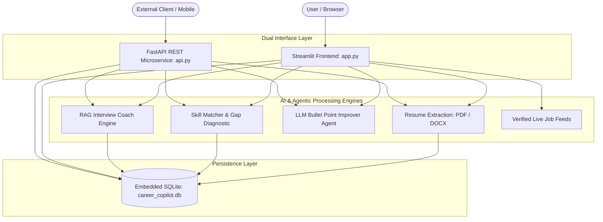

+# Career Copilot AI — Production-Quality Engineering Career Navigator

An AI-powered, modern web application built for engineering students, fresh graduates, and tech job seekers to analyze resumes, match job descriptions, explore specialized engineering roles, identify skill gaps, generate tailored resumes, build proof-of-work portfolio projects, track weekly learning roadmaps, and manage their job applications.

---

## 1. Visual Identity & Color System

Designed with a SaaS aesthetic tailored for engineering portfolios:

- **Primary Navy:** `#123B63` — Sidebar headings, primary text, brand accents
- **Deep Navy:** `#0B1F3A` — Sidebar background, dark hero gradients
- **Sky Blue:** `#38BDF8` — Selected active states, highlights, interactive accents
- **Pale Sky Blue:** `#E0F2FE` — Subtle badges, soft highlight containers
- **White:** `#FFFFFF` — Cards and text contrast
- **Page Background:** `#F7FAFC` — Soft cool-white canvas
- **Borders:** `#E2E8F0` — Clean structural delineation
- **Status Indicators:**
  - Success: `#16A34A`
  - Warning: `#D97706`
  - Error: `#DC2626`
- **Typography:** Inter sans-serif typeface, accessible contrast ratios, and Lucide SVG iconography.

---

## 2. Core Architectural Modules



### Module Breakdown

1. **`app.py`**: Streamlit web frontend with SaaS visual identity, responsive navigation, and user profile management.
2. **`api.py`**: Production **FastAPI REST API** with automated OpenAPI/Swagger documentation (`/docs`), Pydantic validation, and endpoints for resume parsing, job matching, bullet optimization, RAG interview generation, and application tracking.
3. **`modules/rag/interview_coach.py`**: **RAG-based Interview Coach** that chunks and retrieves semantic context from the candidate's resume and target job requirements to generate tailored Technical Deep-Dive, Skill-Gap, and Behavioral questions with automated **STAR framework evaluation**.
4. **`modules/agent/bullet_improver.py`**: **LLM-Powered Resume Improvement Agent** supporting Google XYZ impact formula, Senior Systems Engineering, Job Keyword Infusion, and Executive Brevity.
5. **`modules/parsers/resume_parser.py`**:
   - Supports text-based PDF (via PyMuPDF and pypdf) and DOCX (via python-docx and zipfile XML).
   - Extracts contact details (Email, Phone, LinkedIn, GitHub).
   - Categorizes technical skills across 6 core tech domains.
   - Evaluates bullet points against the Google XYZ formula: *Accomplished [X] as measured by [Y] by doing [Z]*.
   - Calculates structural ATS readiness score (0-100).
6. **`modules/matching/matcher.py`**:
   - Classifies job requirements into **Required Qualifications** vs **Preferred / Bonus Skills**.
   - Calculates a transparent composite score: `50% Required Coverage + 20% Preferred Coverage + 30% Semantic Relevancy`.
   - Explicitly disclaims that match score measures text alignment rather than hiring probability.
7. **`modules/data/roles_data.py`**: Deep profiles for 9 high-demand engineering tracks (AI Engineer, Machine Learning Engineer, NLP Engineer, Data Scientist, Data Analyst, Python Software Engineer, Backend Developer, Generative AI Engineer, MLOps Engineer).
8. **`modules/data/projects_data.py`**: Concrete production project blueprints with objectives, demonstrated skills, step-by-step milestones, testing gates, and GitHub deliverable checklists.
9. **`modules/data/roadmap_data.py`**: 4-week structured curricula with interactive milestones, interview questions, and persistent checkbox tracking.
10. **`modules/jobs/job_service.py`**: Fetches verified openings from public REST APIs (Remotive) and verified tech company career portals (Google, Anthropic, Databricks, Stripe, OpenAI, Meta, Spotify).
11. **`modules/ui/pages_builder.py`**: Live A4 resume preview with job-tailoring recommendations and HTML/print-ready download.
12. **`modules/ui/pages_tracker.py`**: Pipeline manager supporting *Interested*, *To Apply*, *Applied*, *Interview*, *Offer*, and *Rejected* statuses.

---

## 3. Getting Started

### Prerequisites
- Python 3.10+ (tested with Python 3.10, 3.11, 3.12, 3.14)
- Git

### Installation

```bash
# Clone the repository
git clone https://github.com/your-username/career-copilot-ai.git
cd career-copilot-ai

# Create virtual environment (optional)
python -m venv .venv
source .venv/bin/activate  # On Windows: .venv\Scripts\activate

# Install dependencies
pip install -r requirements.txt
```

### Launch the Application

#### Option A: Streamlit Interactive Web Application
```bash
streamlit run app.py
```
Open your browser to `http://localhost:8501`.

#### Option B: FastAPI Backend Microservice (with Interactive Swagger UI)
```bash
uvicorn api:app --reload --port 8000
```
- Interactive Swagger UI: `http://localhost:8000/docs`
- ReDoc Documentation: `http://localhost:8000/redoc`

---

## 4. Automated Testing

Run the full automated test suite with pytest:

```bash
python -m pytest -v tests/test_copilot.py
```

### Test Coverage Includes:
- User profile persistence and updates
- Application tracker CRUD operations
- Contact and taxonomy extraction from resumes
- Weak bullet point detection and Google XYZ rewrite suggestions
- Required vs Preferred skill extraction in job matching
- 9 career role taxonomy integrity
- Interactive roadmap task persistence in SQLite
- Real job filter logic

---

## 5. Deployment Options

### Streamlit Community Cloud
1. Push this repository to GitHub.
2. Sign in to [share.streamlit.io](https://share.streamlit.io/).
3. Connect your repository, select branch `main`, and specify `app.py` as the entrypoint.
4. Deploy!

### Docker Container
A standard container build can be created with:

```dockerfile
FROM python:3.11-slim
WORKDIR /app
COPY requirements.txt .
RUN pip install --no-cache-dir -r requirements.txt
COPY . .
EXPOSE 8501
CMD ["streamlit", "run", "app.py", "--server.port=8501", "--server.address=0.0.0.0"]
```

Build and run:
```bash
docker build -t career-copilot-ai .
docker run -p 8501:8501 career-copilot-ai
```

---

## 6. License & Ethics Notice

This application strictly adheres to ethical AI and ATS transparency guidelines:
- **Zero Fabrication:** Never invents degrees, employment history, certifications, or false metrics.
- **Transparent Calculations:** All match percentages explain their mathematical weights and explicitly state they do not represent hiring probabilities.
- **Authentic Opportunities:** Job listings contain real external URLs to verified company career portals.

